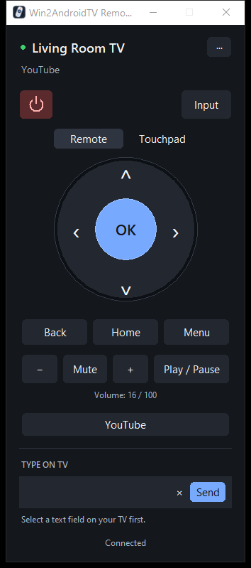

# Win2AndroidTV Remote

A simple Wi-Fi remote for **Android TV and Google TV**, available for **Windows** and **Android phones**. Pair once, then control your TV directly—no PC server, TV developer mode, or ADB required.

<p align="center"></p>
<p align="center"><sub>Current Windows interface, shown with sample TV connection details.</sub></p>

| Platform | Requirements | Build output |
|---|---|---|
| Windows | Windows 10 / 11 | `dist/Win2AndroidTVRemote.exe` |
| Android phone | Android 7.0+, 64-bit ARM or x86 | `dist/TV-Remote-Android.apk` |

[Windows setup](#download-and-run) · [Android setup](#android-phone-app) · [Build from source](#run-from-source)

## Features

- **Touchpad navigation** – drag on the pad to move Up / Down / Left / Right. Click is OK, right-click is Back, middle-click is Home.
- **Remote layout** – a large circular D-pad with OK in the center, rounded controls, and a compact body. Switch to **Touchpad** for gesture navigation.
- **Live volume display** – see the TV's reported volume and mute state.
- **Hover mode** – move the pointer on the pad to navigate, with no click.
- **Volume** – mouse wheel or two-finger scroll, PgUp / PgDn, `+` / `−`, and Mute.
- **Type with your keyboard** – the text you type shows in the TV search box at the same time.
- **Buttons** – Back, Home, Menu, Play/Pause, Power, Input, Settings and app shortcuts (YouTube by default).
- **Auto-discovery** – finds the TVs on your network. Pair one time and it connects automatically after that.
- **No developer mode, no ADB** – it uses the Android TV Remote protocol v2, the same protocol as the Google TV phone app.
- **Always on top** option in the **···** menu, alongside Change TV, hover navigation, TV settings, and keyboard help.
- **Right-side startup** – the Windows remote opens near the right edge, with room for the taskbar.

The features and keyboard shortcuts below describe the Windows app. The Android app uses the same remote-style controls, phone volume buttons, and explicit **Send text** / **Enter** actions.

## TV requirements

- An Android TV or Google TV device (TV, Chromecast with Google TV, NVIDIA Shield, Mi Box, and others) with the **Android TV Remote Service**. Most devices have it.
- Your laptop or phone and the TV must be on the same network.

## Download and run

1. Download `Win2AndroidTVRemote.exe` from the [Releases](../../releases) page.
2. Double-click it. You do not need Python.
3. If Windows SmartScreen shows a warning, click **More info**, then **Run anyway**. The exe has no code signature.
4. If Windows Firewall asks, allow network access. The app must find the TV on your network.

Release downloads may lag behind the current source and screenshot. To build the latest Windows version, run `build.bat`.

## Android phone app

The Android app connects directly to your TV and works independently of the Windows app.

1. Build the APK using the command below, or use `TV-Remote-Android.apk` if supplied with a release.
2. Copy the APK to your phone and open it. Allow installation from your file manager if Android asks.
3. Open **TV Remote**, tap **TVs**, select your TV or enter its IP address, then pair using the code on the TV.

```powershell
./android/build.ps1 -Setup
```

Requires Python 3.12 on the build PC. The script downloads the JDK, Gradle, and Android SDK into the project's ignored build directory; Android Studio is not required. Later builds use `./android/build.ps1`.

The APK includes discovery, pairing, D-pad, touchpad, volume, playback, power, input, settings, YouTube, and text entry. Pairing stays in private app storage. The app disconnects in the background and reconnects when reopened.

The current APK is debug-signed for personal installation. Build and signature checks and protocol-adapter tests pass; live phone-to-TV testing has not yet been completed. See the [Android README](android/README.md) for controls and build details.

## First connection

1. The app searches for TVs. Double-click your TV in the list, or type its IP address and click **Connect**.
2. Click **Yes** to pair. A 6-character code (0–9 and A–F) shows on the TV screen.
3. Type the code in the app.

The app keeps the pairing. The next time, it connects automatically.

To switch TVs in the Windows app, open **··· → Change TV**.

## Controls

| Action | Mouse / trackpad | Keyboard |
|---|---|---|
| Move | Click the navigation ring, or drag in Touchpad mode | Arrow keys |
| OK | Click the center OK button, or tap the touchpad | Enter |
| Back | Right-click on the pad | Esc or Backspace |
| Home | Middle-click on the pad | Home |
| Volume up / down | Wheel or two-finger scroll | PgUp / PgDn or `+` / `−` |
| Mute | – | M or F8 |
| Play / Pause | – | Space |
| Menu | – | F1 or the Menu key |
| Type text | Click the text box | T or `/` |

**Type text:** first select a search box on the TV. Then type in the app text box. Press Enter to send the search. Press Esc to go back to navigation.

Typing sends only changed characters, including edits and pasted text. Keep the TV cursor at the end of the field while editing from the laptop. The local text box resets when the connection is lost or you change TVs; select the intended TV field again after reconnecting.

## Settings

Settings, the pairing certificate and a log file are in `%APPDATA%\TvRemote\`.

To change the app shortcuts, edit `"apps"` in `config.json`. Use a deep link or an Android package name:

```json
"apps": [
  ["YouTube", "https://www.youtube.com"],
  ["Netflix", "https://www.netflix.com/title"]
]
```

To pair again, delete `cert.pem` and `key.pem`.

## Run from source

Install Python 3.10 or later, then run:

```bat
run.bat
```

`run.bat` makes a `.venv`, installs the requirements and starts the app.

## Build the exe

```bat
build.bat
```

The result is `dist\Win2AndroidTVRemote.exe`.

## Run regression tests

After installing the requirements, run `.venv\Scripts\python.exe -m unittest discover -s tests -v`.
Tests cover keyboard text changes, wheel events, pairing retries, connection switching, settings, and shutdown without needing a TV.

To preview the Windows UI with sample TV data, run `.venv\Scripts\python.exe tools\preview_ui.py`. It does not connect to a real TV or save settings. Add `--screenshot` to refresh `docs/screenshot.png` (Windows and Pillow required).

## Troubleshooting

- **No TV in the list** – make sure that the TV is on and on the same network. Type the TV IP address manually. Some routers block device discovery (mDNS).
- **Cannot connect** – on the TV, make sure that the *Android TV Remote Service* app is installed and up to date.
- **Text does not show on the TV** – select a text field on the TV first. Some apps do not accept text from a remote keyboard.
- **Errors** – look in `%APPDATA%\TvRemote\log.txt`.

## Credits

- [androidtvremote2](https://github.com/tronikos/androidtvremote2) – Android TV Remote protocol v2 library.
- [python-zeroconf](https://github.com/python-zeroconf/python-zeroconf) – network discovery.
- [Chaquopy](https://github.com/chaquo/chaquopy) – Python protocol library integration for the native Android app.

## License

[MIT](LICENSE)
